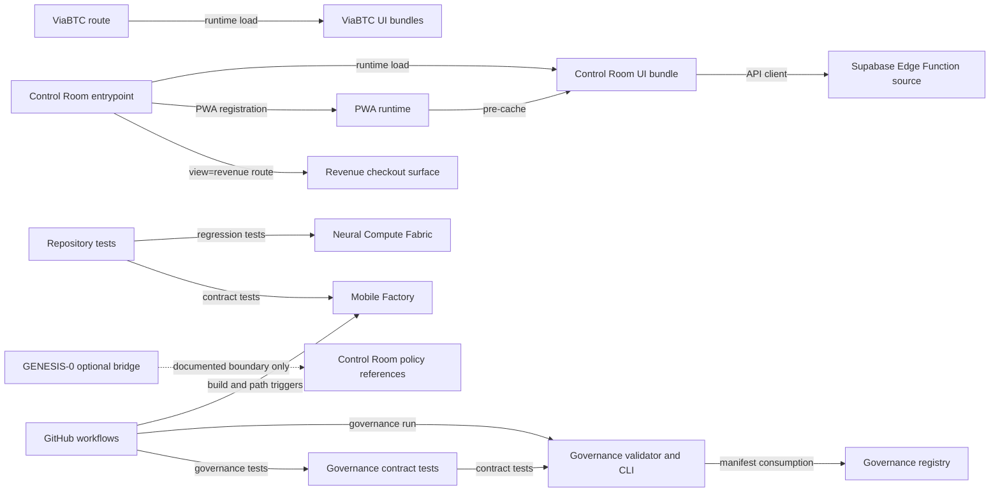

# MIDAD Dependency Map

This view is generated conceptually from `architecture/governance/manifest.json`. Edges are evidence-backed and directional: **A → B means A consumes, loads, tests or is governed by B**, according to the relationship label.

## Edge interpretation

| From | To | Relationship | Evidence | Impact propagation |
|---|---|---|---|---|
| Control Room entrypoint | Control Room UI bundle | Runtime load | `index.html` loads the main CSS/JS assets | Yes |
| Control Room entrypoint | PWA runtime | PWA registration | `index.html` links the manifest/icon and registers the worker | Yes |
| Control Room entrypoint | Revenue checkout surface | Route redirect | `index.html` redirects `view=revenue` to `revenue-forge.html` | Yes |
| Control Room UI bundle | Supabase Edge Function source | API client | `midad-control-v2.js` defines the `midad_control_room` endpoint | Yes |
| ViaBTC route | ViaBTC UI bundles | Runtime load | `viabtc.html` references the `neuralpp-v1` assets | Yes |
| Repository tests | Neural Compute Fabric | Regression tests | `tests/midad-linux-worker.test.mjs` imports the worker runtime | Yes |
| Repository tests | Mobile Factory | Contract tests | `tests/mobile-factory-version-contract.test.mjs` reads the product manifest/package | Yes |
| GitHub workflows | Mobile Factory | Build/path triggers | `midad-mobile-android.yml` filters `mobile/**` and renders the product | Yes |
| GENESIS-0 bridge | Control Room policy references | Documented optional boundary | `midad-genesis0/MIDAD_INTEGRATION.md` describes the bounded handoff and says it is not production-connected | No |
| Governance tooling | Governance registry | Manifest consumption | `tools/architecture-governance/cli.mjs` reads `architecture/governance/manifest.json` | Yes |
| Governance tests | Governance tooling | Contract tests | `tests/architecture-governance.test.mjs` imports the validator and impact/audit functions | Yes |
| GitHub workflows | Governance tooling and tests | CI execution | `architecture-governance.yml` runs the CLI and test suite | Yes |
| PWA runtime | Control Room UI bundle | Pre-cache runtime assets | `service-worker.js` CORE list caches the main UI JavaScript/CSS assets | Yes |
| Architecture docs | Governance registry | Documentation | `ARCHITECTURE_GOVERNANCE.md` describes the registry and validation contract | No |

## Intentionally isolated projects

- **midad-intelligence** is a separate read-only discovery subsystem. No direct Control-room runtime edge was asserted in this audit.
- **midad-community** is a static demo with synthetic data and no production integration.
- **GitHub profile** and **GitHub-Clone** are separate from the MIDAD application.
- **Maleh** remains unclassified; no dependency edge is inferred.

The absence of an edge means no dependency was asserted from inspected evidence. It is not a claim that no future or undocumented relationship could exist.
