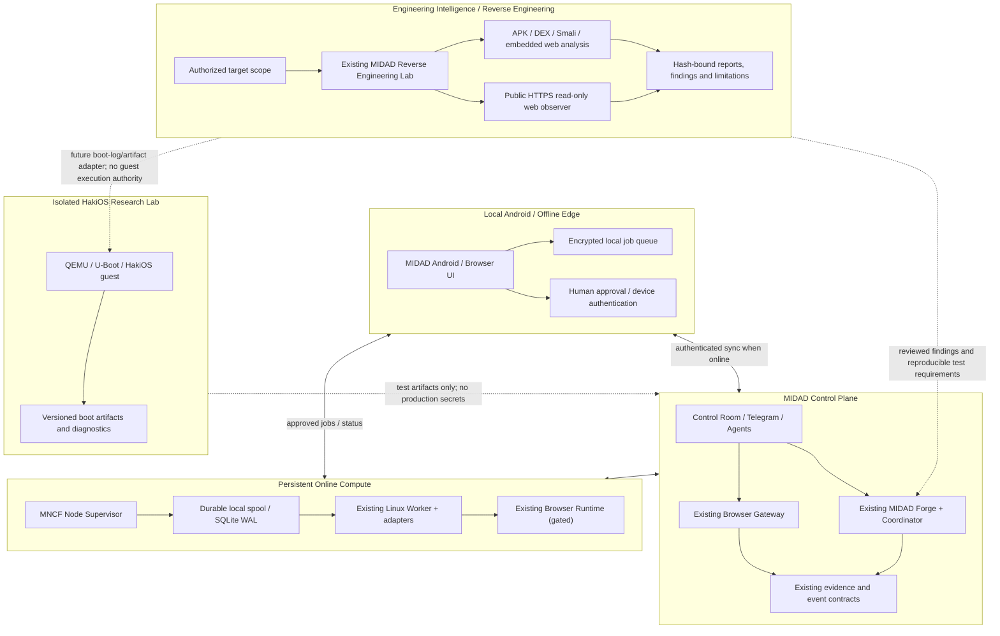

# MIDAD HakiOS Hybrid Runtime Architecture

**Status:** Proposed canonical target architecture; implementation is gated by host inspection and runtime verification.  
**Date:** 2026-11-08  
**Repository baseline:** `Sirahwaz/Control-room` at `2670dea8aafef0a65deac58ae7e7e9626042793e`  
**Governing principle:** Audit → Preserve → Repair → Integrate → Upgrade. “From zero” means resetting the architecture decision and documenting explicit boundaries; it does not mean deleting or rewriting working modules.

## 1. Executive decision

Adopt a **hybrid, provider-agnostic architecture**:

1. **Persistent Linux host** is the online execution node. The already-created NeoHeberg Debian VPS is the first candidate, subject to read-only inspection and resource validation. It is not yet a verified production node.
2. **Android device / Android environment** is the local edge and human-interaction node: browser UI, operator approval, small local tasks, and durable offline queue. It is not the authoritative 24/7 server.
3. **HakiOS + QEMU** remains an isolated operating-system research lab until it demonstrates stable boot, a persistent userspace session, storage, and controlled networking. It is not a production server today.
4. **GitHub Actions Linux** remains an ephemeral build/test provider. It must never be reported as a persistent server.
5. **MIDAD Reverse Engineering Lab is a first-class Engineering Intelligence Plane**: it inspects authorized APKs, DEX/Smali, embedded web bundles, public read-only web surfaces and—through incremental adapters—HakiOS boot artifacts/logs before engineering changes. Preserve `tools/midad-re-lab/` and its existing workflows; do not create a parallel lab.
6. **Existing MIDAD Control Plane and contracts** remain authoritative: Control Room, current MIDAD orchestration, Browser Gateway, MIDAD Forge and its existing `midad_forge_projects`, `midad_forge_runs`, and `midad_forge_events` tables. Do not create a replacement orchestrator or database queue without demonstrated need.

This separates where work is controlled, where it executes, where it is tested, and where it is queued while offline.

## 2. Local vs virtual vs hybrid decision

| Environment | Best role | Strength | Limitation | Decision |
|---|---|---|---|---|
| Native Linux on an always-on local computer | Local persistent worker | Direct kernel access, predictable services, local control | No such always-on host is currently verified; device availability and power/network matter | Supported as a future additional MNCF node |
| Android + Termux / PRoot Linux userland | Mobile edge / offline utilities | Runs locally without a separate VM; useful for shell tools and small processes | PRoot does not provide real root, kernel namespaces/cgroups, or a normal systemd service manager; Android may constrain background work | Optional edge runtime, not production server |
| Full Linux VM under QEMU | Isolated guest OS and HakiOS research | Boots a separate guest kernel and virtual hardware | Needs sufficient RAM/storage and preferably hardware acceleration; software emulation can be slow; nested VM support is unverified | Research/lab only until capability gates pass |
| Remote Linux VPS | Online persistent worker | Independent uptime and native Linux service management | Provider resources, disk, network and access must be measured; small VPS cannot be assumed to run Chromium | Primary online node candidate |
| GitHub Actions Linux | Builds, tests, reproducible jobs | Already integrated and bounded | Ephemeral by design | Keep for CI and one-shot compute |

**Decision:** Hybrid is the correct target. Use the VPS candidate for online persistence, Android for local/offline operation and human interaction, HakiOS/QEMU for OS experiments, and GitHub Actions for ephemeral builds. A future physical Linux host may join through the same worker contract without changing the control plane.

### Important distinction: Linux inside Android is not the same as a Linux VM

Termux runs compatible programs natively on Android's Linux-based kernel. PRoot can supply a Debian/Ubuntu/Alpine userspace without root, but it does not turn Android into an independently booted Linux server. PRoot's own documentation explicitly lists limitations around real root, systemd/service supervisors, namespaces and cgroups. Android also has background-execution limits. Therefore, a PRoot Debian session is useful for local development and small utilities, not the authoritative always-on MIDAD server.

A full QEMU system guest is different: QEMU models a guest machine and can run a separate guest OS. Hardware acceleration depends on a supported host hypervisor/architecture; availability on the current HakiOS or Android environment has not been verified.

References:
- https://github.com/termux/proot-distro
- https://github.com/termux/termux-packages/wiki/Termux-execution-environment
- https://developer.android.com/develop/background-work/services/fgs/timeout
- https://www.qemu.org/docs/master/system/introduction.html

## 3. Target architecture

### Plane responsibilities

**A. Control Plane — retain existing services**
- Control Room remains the explainable command surface.
- Existing MIDAD Forge and coordinator continue to own project/run orchestration.
- Existing Browser Gateway continues to authorize browser jobs and record evidence.
- Telegram bots remain control/notification clients, not independent sources of job truth.
- Do not move secrets into the Android APK or GitHub Actions artifacts.

**B. Online Compute Plane — persistent Linux node**
- A small supervisor registers one MNCF node identity, reports health/capacity, leases only authorized jobs, and restarts its worker through the host's native service manager.
- Preserve and integrate `compute/mncf/runtime/worker.mjs`; do not replace its bounded execution contract.
- Reuse `tools/midad-browser-runtime/` modules: `operator_worker.py`, `persistent_session.py`, `secret_provider.py`, `operator_command_router.py`, `account_registry.py`, and existing tests.
- The node makes outbound authenticated connections to MIDAD wherever possible. Do not expose browser debugging, VNC, database, or worker-control ports publicly.
- On the reported 1-vCPU / 512-MiB / 5-GB candidate, begin with supervisor, health reporting, small Node worker and durable spool only. Do not install Chromium, Docker, QEMU, or a full browser stack until measured free memory/storage demonstrate safe headroom.

**C. Engineering Intelligence Plane — MIDAD Reverse Engineering Lab**
- Preserve the existing `tools/midad-re-lab/` analyzers, fixtures, tests and two workflows. This is the mandatory discovery/evidence path before changing unfamiliar systems.
- Current source-reviewed capabilities: APK intake/hash and manifest/archive analysis; JADX/APKtool decompilation; multi-DEX and Smali summaries; static inspection of embedded HTML/CSS/JS and Capacitor bridges; and a bounded public HTTPS web observer.
- Keep the distinction between archive-static analysis and browser-assisted page observation. The embedded web-bundle analyzer does not execute JavaScript or make network requests. The web observer renders the authorized target in headless Chromium, permits only GET/HEAD requests to the same public host, blocks cross-host/private-address requests, and does not log in or submit forms.
- Produce hash-bound findings with tool versions, scope, limitations, confidence and reproducible test cases. Keep secrets, cookies, credentials, wallet material and private source out of reports.
- The RE Lab currently stores workflow reports as CI artifacts; live Evidence Ledger ingestion and Forge orchestration are future integrations, not existing verified connections.
- For HakiOS, add read-only adapters incrementally for source/config diffs, checksums, QEMU/U-Boot/UEFI/XNULOADER logs, memory maps and boot-stage classification. Do not execute unknown payloads on the persistent VPS.
- **Analysis does not authorize action.** A reviewed finding may become a Forge/MNCF engineering task only through existing authorization, idempotency, human approval and evidence contracts.

**D. Local Android / Offline Edge**
- Keep the native MIDAD Android app and browser surface as the local interface.
- Store a bounded offline queue with stable job IDs, idempotency keys, timestamps, expiry and state transitions.
- Use Android platform-protected storage for device-bound secrets. Never store account passwords, raw cookies, wallet keys or service-role keys in queue payloads.
- Offline work is limited to drafts, local notes, cached read-only data and low-risk preparation. Payments, account creation, credential changes, submissions, publication, and other high-impact actions remain online and require the existing human-approval policy.
- When connectivity returns, reconcile by idempotency key and server state; never blindly replay an expired or already-completed action.

**E. HakiOS Lab — independent research boundary**
- Keep HakiOS/QEMU research separate from the online worker.
- Preserve the existing U-Boot path and its evidence; continue investigating UEFI-ESP and loader-device failures independently.
- A successful one-shot userspace print is not a stable OS session. Stable PID 1, persistent storage, restart behavior, networking isolation, and recovery must be tested separately.
- No production credentials, wallet operations, or account sessions inside the HakiOS research guest.
- The current repository evidence does not prove that an Android guest is booted inside HakiOS. The Android emulator workflow in this repository builds/installs/tests APKs in GitHub Actions; it is not proof of a permanent Android VM embedded in the HakiOS guest.

## 4. Runtime and security contracts

### Node lifecycle

`DISCOVERED → ATTESTED → READY → LEASED → RUNNING → EVIDENCE_RECORDED → ACKNOWLEDGED`

Exceptional states: `DEGRADED`, `OFFLINE`, `QUARANTINED`, `FAILED`.

- Each node has a unique identity and a revocable credential.
- Each job has an immutable job ID, idempotency key, expiry, policy scope, and expected evidence contract.
- A lease expires; a restarted worker must reconcile before executing again.
- The worker records evidence before acknowledging completion.
- A stale or unauthenticated node cannot fetch jobs or upload arbitrary evidence.
- Keep the existing bounded command/file/path protections in the MNCF worker; do not weaken them for convenience.

### Security baseline

- Zero-trust: least privilege, key-only SSH after access is verified, no root service process, no secrets in source control, APKs, logs, or artifacts.
- Keep public inbound application ports closed. Remote administration must use a verified authenticated access path; the current manifest's policy is no direct public SSH/VNC service exposure.
- Do not disable password authentication or alter firewall rules until a second authenticated session has been tested and a rollback path exists.
- Use a dedicated unprivileged service account and a hardened native service definition. Apply resource limits only after observing real usage.
- Encrypt persistent account profiles and protect encryption keys separately from the profile data. Never treat closing a browser context as proof that a website logged out.
- Maintain bounded logs, storage quotas, retention, health checks, and an operator kill switch.
- Human approval remains mandatory for irreversible, financial, account, publication, or externally visible actions.

### Data and queues

- Existing MIDAD Forge tables remain the authoritative project/run/event contract.
- The VPS may keep a local SQLite WAL spool for durability during temporary control-plane outages; this is a transport/recovery spool, not a second global source of truth.
- Android uses a separate bounded local queue for offline drafts and eligible low-risk jobs.
- Do not add Supabase tables, migrations, Edge Functions or GRANT/RLS changes as part of the initial runtime deployment. The current Supabase write path is not verified in the MNCF manifest.
- All sync/replay paths require idempotency, expiry, ownership, and evidence checks.

## 5. Phased implementation roadmap

### P0 — Baseline and preserve (read-only first)
1. Capture the current main commit, open HakiOS-related PRs and CI states.
2. Inspect the actual VPS: OS, architecture, CPU, RAM, disk, filesystem, IPv4/IPv6, systemd, virtualization flags, package state and network reachability. Do not print environment variables, credentials, or private key material.
3. Inventory the actual Android virtual environment and determine whether it is: (a) Android Emulator in CI, (b) Android running as a guest under QEMU, or (c) a local Android device/app. Record evidence, not assumptions.
4. Audit existing worker, Gateway and Android app contracts before adding a daemon or queue.
5. Inventory the existing Reverse Engineering Lab analyzers/workflows and retain a baseline test/report set; use its authorized evidence path before changing unfamiliar APK, browser, kernel or firmware components.

**Exit criteria:** host facts recorded; actual Android/HakiOS topology identified; no production state changed.

### P1 — Establish the persistent MNCF node
1. Validate that the VPS has enough free resources for a small service.
2. Harden the host conservatively; preserve a tested recovery/admin path.
3. Install only the minimum required Node runtime and service dependencies.
4. Create a dedicated unprivileged MIDAD service identity and systemd unit.
5. Start a heartbeat-only supervisor first. It must report node identity, version, uptime, memory, disk and health—no job execution yet.

**Exit criteria:** service survives restart/reboot; heartbeat is authenticated; no public control port is exposed; resource overhead is measured.

### P2 — Durable execution and recovery
1. Add bounded SQLite WAL local spool with schema version, expiry, idempotency and recovery tests.
2. Integrate with existing MIDAD Forge/Gateway contracts instead of creating a new orchestrator.
3. Implement lease/reconcile/acknowledge behavior and duplicate-delivery tests.
4. Test host reboot, process crash, network loss, reconnect, expired jobs and corrupted spool recovery.

**Exit criteria:** queued job survives restart and is never executed twice after reconciliation; evidence is recorded before acknowledgement.

### P3 — Browser Runtime integration
1. Connect the existing Browser Gateway to the persistent worker using the existing owner/approval boundaries.
2. Deploy lightweight metadata-only/read-only jobs first.
3. Test session persistence only for explicitly authorized owner sessions and use the existing Secret Provider boundary.
4. Measure Chromium memory and disk separately. Enable full browser execution only if the VPS has safe headroom; otherwise route browser work to a measured-capacity node or keep it user-operated on Android.

**Exit criteria:** exact host allowlists, safe request filtering, session recovery, logout semantics, evidence ledger and kill switch all pass tests.

### P4 — Android offline edge
1. Add/verify local job storage in the existing Android app rather than introducing another app.
2. Support offline drafts, status cache and human approvals.
3. Implement reconnect reconciliation with idempotency and expiry.
4. Test app process termination, device restart, connectivity changes, storage limits and duplicate sync.

**Exit criteria:** local queue survives app/device restart; no prohibited action executes offline; reconnect does not duplicate completed jobs.

### P5 — HakiOS research progression
1. Finish the existing QEMU boot-path differential work without changing production runtime.
2. Verify stable guest session, persistent disk, process supervision and isolated networking.
3. Only then evaluate whether a Linux guest can be launched inside the HakiOS lab and what the hardware/virtualization cost is.
4. Treat Android-in-HakiOS as a separate guest integration only if the source, boot artifact, target architecture and runtime tests prove it exists.

**Exit criteria:** repeatable guest boot and shutdown, persistent data, bounded resource use, network isolation and reproducible evidence.

### P6 — Online/offline operational readiness
- Control Room can see node state, queued/running jobs, last heartbeat, resource pressure, last evidence and blockers.
- Operators can pause/quarantine/revoke a node without destroying its data.
- Recovery procedure, backup/restore test and architecture drift checks are documented.
- Production cutover is an explicit, evidence-backed decision—not an automatic consequence of a green CI run.

## 6. Verification gates and capacity policy

The Reverse Engineering Lab is a cross-cutting prerequisite for changes to unfamiliar Android, browser, firmware, loader, kernel and third-party components. Its existing test suite is not a substitute for a live target report; each investigation must record its own authorization, target identity, hashes, methods, evidence, confidence and limitations.

| Gate | Required evidence | Initial state |
|---|---|---|
| Persistent Linux host | SSH access verified, OS/resources measured, systemd and storage validated | PENDING |
| MNCF supervisor | Authenticated heartbeat, restart test, resource baseline | NOT IMPLEMENTED |
| Durable server spool | WAL durability, crash/restart, idempotency tests | NOT IMPLEMENTED |
| Browser job integration | Gateway authorization, safe host/network policy, evidence acknowledgement | PARTIAL / EXISTING COMPONENTS |
| Android offline edge | On-device persistence + reconnect tests | NOT VERIFIED |
| HakiOS stable guest | Repeatable persistent userspace session | NOT VERIFIED |
| Reverse Engineering Lab baseline | Existing analyzer tests; authorized target scope; hash-bound report and limitations | COMPONENTS EXIST / LIVE CASE BASELINE PENDING |
| HakiOS RE adapters | Reproducible QEMU/U-Boot/UEFI log classification and artifact/config provenance | PLANNED |
| Android guest inside HakiOS | Guest source, boot path and runtime evidence | NOT VERIFIED |
| Production cutover | All required gates, rollback and human approval | BLOCKED |

### Resource policy for the first VPS candidate

The resource figures previously reported for NeoHeberg (1 vCPU, 512 MiB RAM, 5 GB SSD) are **user-reported and not re-measured in this repository baseline**. Treat the host as a constrained node until the read-only inventory is complete.

Initial allowed scope:
- small Node supervisor / heartbeat;
- a bounded local job spool;
- lightweight health and evidence relay;
- no Docker daemon, no QEMU, no database server, no full desktop, and no Chromium until separately justified by measured capacity.

If the host cannot safely support the worker, do not force it. Keep the node disabled and use existing ephemeral CI only for the permitted one-shot workloads while a suitable no-cost persistent node is evaluated.

## 7. Immediate execution sequence

1. Complete read-only inspection of the actual VPS from the user's SSH client; share only sanitized command output.
2. Record the Android/HakiOS boot topology from the actual environment or its build artifacts.
3. Update the MNCF manifest from measured facts only.
4. Implement a heartbeat-only node adapter behind a feature flag, with tests before any job execution.
5. Progress through P2–P6 one gate at a time; no production cutover until explicitly approved.

## 8. Rollback and non-goals

- No deletion or move of current runtime/browser/mobile/HakiOS modules in this architecture change.
- No replacement of Supabase, MIDAD Forge, Browser Gateway, or Control Room.
- No new paid service, metered browser provider, Docker layer, or external compute purchase.
- No VPS firewall/SSH mutation until access recovery is proven.
- No wallet, payment, account creation, website submission, publication, or other irreversible action from an experimental guest.
- Rollback means stop/disable the new supervisor, preserve the spool and evidence, revoke its node credential, and return execution to the existing authorized paths. Do not wipe host data as a rollback shortcut.

## 9. Source evidence reviewed

- `compute/mncf/manifest.json`: ephemeral Linux worker is implemented; persistent host is pending; self-hosted provider is disabled; HakiOS remains an isolated research guest.
- `compute/mncf/runtime/worker.mjs`: bounded Linux worker contract and path/secret protections.
- `.github/workflows/midad-hakios-qemu-smoke.yml`: QEMU research workflow, separate from Android APK tests.
- `.github/workflows/midad-browser-android.yml` and `.github/workflows/midad-mobile-android.yml`: Android APK build/install/runtime smoke in GitHub Actions.
- `tools/midad-browser-runtime/`: existing Browser Runtime, operator worker, persistent-session, secret-provider, account registry and tests.
- `docs/architecture/ARCHITECTURE_GOVERNANCE.md`: repository ownership, dependency and evidence governance.

This document records an architecture decision and roadmap. It does not claim that a VPS was inspected, a Linux service was deployed, an Android guest was booted inside HakiOS, or a production cutover occurred.

## 10. Reverse Engineering Lab — first-class engineering intelligence

The repository audit found an existing and non-trivial lab at `tools/midad-re-lab/`. It must be preserved and treated as a core part of the HakiOS path, not recreated or replaced.

### Verified source inventory

- `analyze_apk.py`: APK validation and hashing, APKtool/JADX analysis, manifest/component inventory, DEX and embedded web bundle reporting.
- `dex_intelligence.py`: bounded multi-DEX parsing, class/method summaries, string indicators and Smali metadata.
- `web_bundle_intelligence.py`: archive-only HTML/CSS/JS inventory, declared/missing asset references, Capacitor/plugin bridge metadata and network/storage/dynamic-execution indicators; its report explicitly marks static-only, no JavaScript execution and no network access.
- `analyze_web.py`: authorized public HTTPS browser-assisted observation with public-address and same-host checks, GET/HEAD-only request guard, metadata-only forms, and no login, form submission or CAPTCHA/evasion.
- `.github/workflows/midad-re-lab-ci.yml`: analyzer compilation and policy/resilience/DEX/web-bundle tests.
- `.github/workflows/midad-re-lab.yml`: optional web-surface analysis, three existing MIDAD APK artifact analysis jobs, and optional authorized external APK analysis. Report artifacts are configured for 14-day retention.

The workflow sources and tests exist. This repository inspection does not establish that all referenced historical artifacts are still downloadable, that a current live analysis report exists, or that reports are written to the production Evidence Ledger.

### Six coordinated engineering tracks

1. **Reverse Engineering / Engineering Intelligence:** identify existing behavior, acquire authorized artifacts, hash inputs, map components/dependencies, capture limitations and build reproducible tests. This track supplies evidence before changes in the other tracks.
2. **HakiOS OS and boot research:** U-Boot, UEFI, XNULOADER, kernel/userspace, QEMU boot paths, memory maps, guest persistence and diagnostics.
3. **MNCF / Linux compute:** persistent node, supervisor, durable local spool, bounded workers and recovery.
4. **Browser Online/Offline Runtime:** Gateway authorization, worker lifecycle, allowlists, owner-session boundaries, safe profiles and evidence acknowledgement.
5. **Android Local Edge:** native UI, local storage, offline queue, human bridge and reconnect reconciliation.
6. **MIDAD Control Plane / Evidence:** Control Room, Forge, Gateway, identity, approvals, observability and evidence/event contracts.

### RE Lab evidence-to-engineering boundary

`Authorized scope → hash-bound acquisition → static/controlled observation → findings + limitations → reproducible regression test → approved Forge/MNCF task → isolated HakiOS/Android/browser verification → human acceptance`.

The lab is not a general-purpose exploit runner. Unknown samples and firmware are never executed on the persistent VPS. Dynamic execution must use a disposable, network-restricted, resource-bounded environment. Analysis findings do not grant authorization to modify a system or perform external actions.

### Immediate RE Lab sequence

- **RE-0:** run the existing CI suite; inventory the actual current APK artifacts and target/source revisions; create a baseline report for each authorized target.
- **RE-1:** standardize a versioned case/report envelope with authorization, hashes, tool versions, findings, evidence references, confidence and explicit partial/failed states.
- **RE-2:** add read-only HakiOS adapters for QEMU/U-Boot/UEFI logs, source/config diffs, firmware pairing, memory-map and boot-stage diagnosis.
- **RE-3:** connect reviewed findings to existing Forge/MNCF contracts with idempotency and human-approval tests; do not create another queue.
- **RE-4:** introduce only necessary isolated dynamic tests after snapshot, resource, network and rollback controls exist.
- **RE-5:** expose case state and evidence references in Control Room through a read-only, auditable surface.

The detailed operating charter and current tool boundaries are maintained in `tools/midad-re-lab/README.md`.
